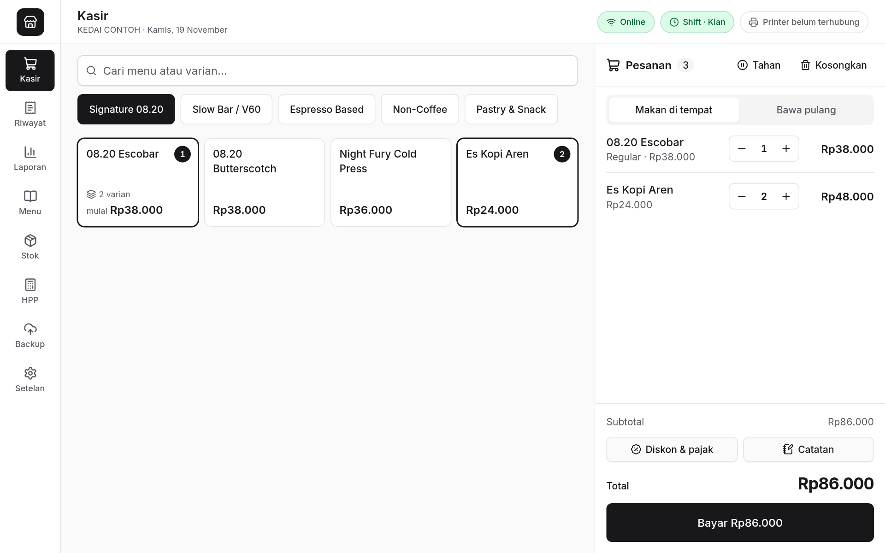
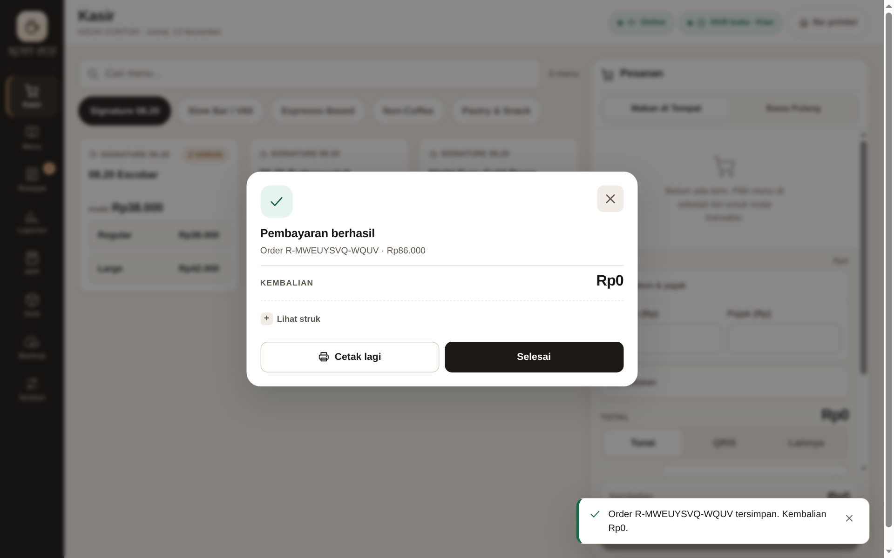
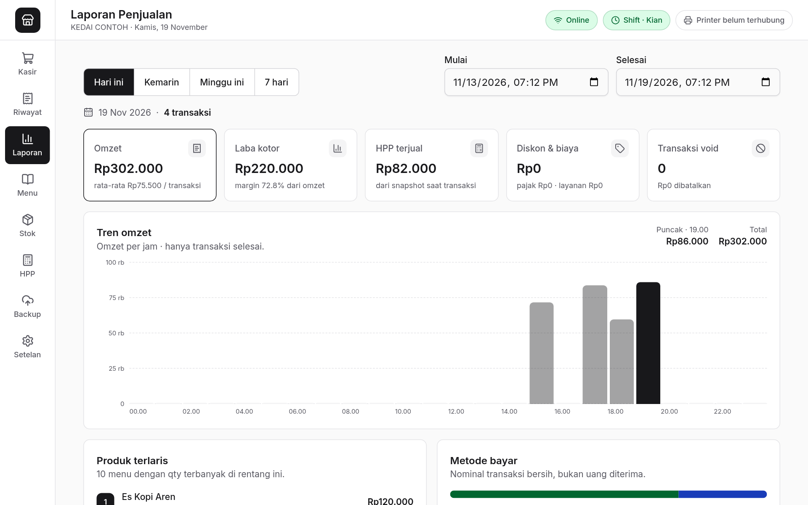
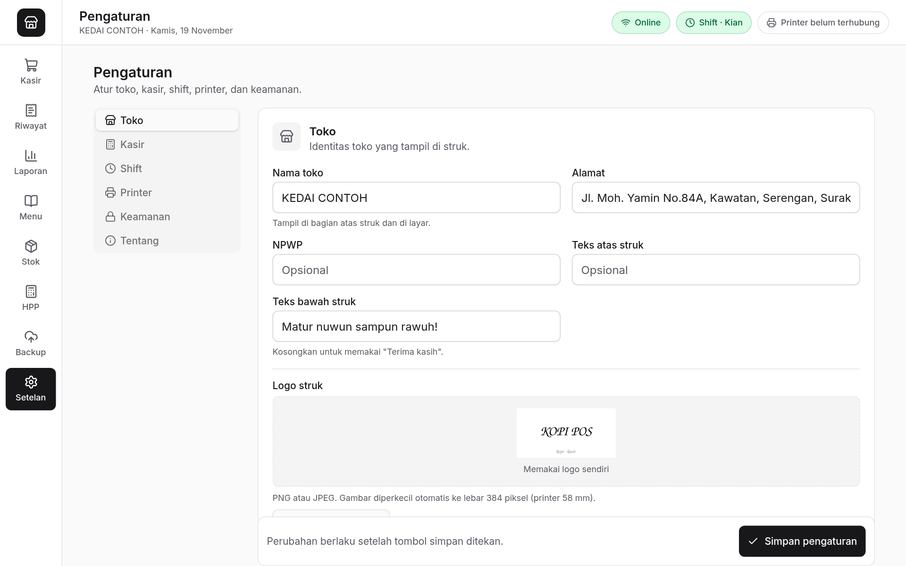
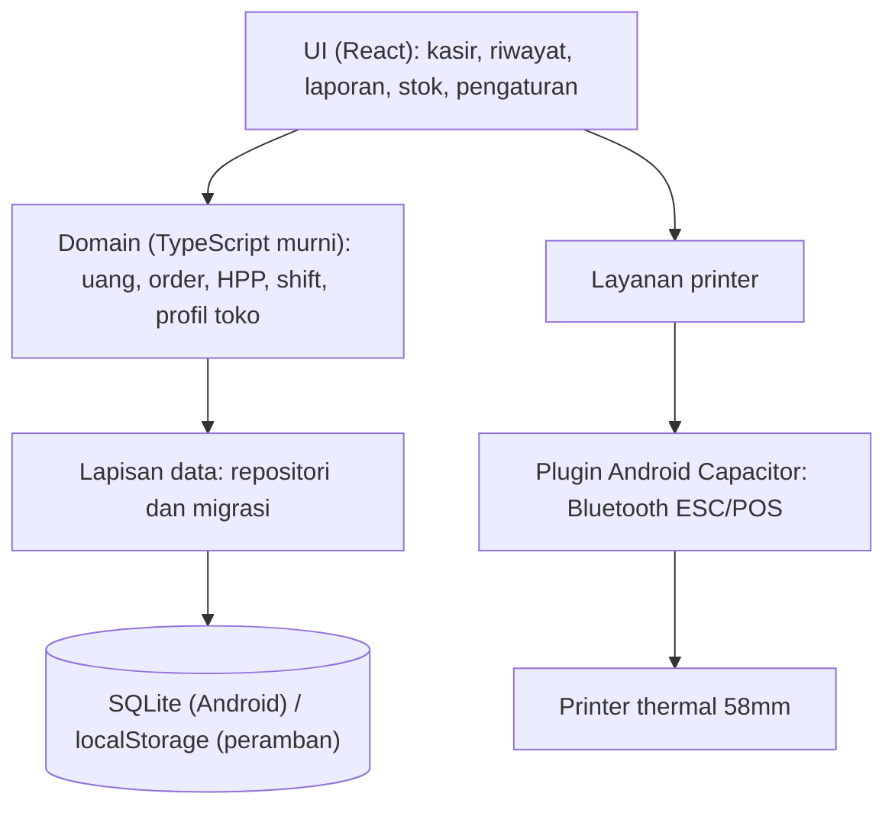

# ☕ Suro POS

[English](README.md) · **Bahasa Indonesia**

<p align="center">
  <strong>Aplikasi kasir (POS) tablet open-source yang berjalan offline untuk kafe dan usaha makanan &amp; minuman kecil, lengkap dengan perhitungan HPP berbasis resep dan cetak struk Bluetooth 58mm.</strong>
</p>

<p align="center">
  <a href="https://github.com/kianlabs/coffee-shop-pos/actions/workflows/ci.yml"></a>
  <a href="LICENSE"></a>
  
  
</p>

---

## Deskripsi

Suro POS berjalan di tablet Android dan menyimpan setiap penjualan di database SQLite lokal pada perangkat, sehingga kasir tetap bisa berjualan saat internet mati. Penjualan disimpan lebih dulu sebelum struk dicetak, harga berupa Rupiah bulat (tanpa pecahan desimal), dan HPP dicatat saat transaksi terjadi sehingga laba historis tidak berubah ketika harga bahan naik.

Proyek ini dibuat agar mudah dipahami: aplikasi web React + TypeScript yang dibungkus Capacitor, dengan seluruh aturan bisnis berupa fungsi murni yang punya unit test.

## Tangkapan Layar

| Kasir | Struk |
| :---: | :---: |
|  |  |

| Laporan penjualan | Pengaturan |
| :---: | :---: |
|  |  |

Tangkapan layar memakai data contoh. Buat ulang dengan `node scripts/capture-tablet-screenshots.mjs` setelah `npm run build`.

## Fitur

- **Kasir untuk tablet**: tombol sentuh besar, pencarian menu, chip kategori, varian, numpad di layar, tahan pesanan, makan di tempat dan bawa pulang.
- **Offline dulu**: semua penjualan, mutasi stok, dan shift disimpan ke SQLite lokal. Sinkronisasi opsional berjalan di latar belakang dan tidak pernah menghambat checkout.
- **Cetak struk**: ESC/POS lewat Bluetooth untuk printer thermal 58mm, termasuk logo toko. Printer yang gagal tidak membatalkan penjualan yang sudah tersimpan.
- **Profil toko**: nama toko, alamat, NPWP, logo, serta teks atas dan bawah struk bisa diubah di Pengaturan. Tidak ada yang tertanam untuk satu toko tertentu.
- **HPP**: perhitungan manual atau berbasis resep, buku besar stok per bahan, dan peringatan margin.
- **Void dan refund**: dilindungi PIN supervisor, dengan penguncian setelah salah PIN berulang. Stok dikembalikan lewat catatan buku besar.
- **Shift dan laporan**: modal awal, rekap shift, penjualan harian dan per jam, produk terlaris, rincian metode bayar, laba kotor.
- **Backup terenkripsi**: ekspor dan pemulihan JSON terenkripsi AES-GCM.
- **Pembaruan langsung**: pembaruan paket web lewat GitHub Releases, dengan rollback otomatis bila paket baru gagal dijalankan.

## Pasang Aplikasi Android

1. Buka [rilis terbaru](https://github.com/kianlabs/coffee-shop-pos/releases/latest) lalu unduh file `.apk`.
2. Di tablet, izinkan pemasangan aplikasi dari peramban atau pengelola file saat Android menanyakan.
3. Buka file yang diunduh lalu pasang.
4. Pasangkan printer Bluetooth lewat pengaturan Android lebih dulu, kemudian hubungkan dari menu **Setelan** di aplikasi.

File APK hanya dipublikasikan di GitHub Releases dan tidak disimpan di repositori.

## Pengembangan

Anda hanya butuh Node.js 20 atau 22. Android SDK tidak diperlukan untuk menjalankan aplikasi di peramban.

```bash
git clone https://github.com/kianlabs/coffee-shop-pos.git
cd coffee-shop-pos
npm install
npm run dev        # http://localhost:5173
```

Perintah yang berguna:

```bash
npm run typecheck  # TypeScript mode strict
npm test           # unit test domain + test penjaga repositori
npm run build      # bundle web produksi
npm run smoke:ui   # smoke test UI Chromium headless (build dulu)
npm run test:e2e   # test alur end-to-end (build dulu)
npm run check      # penjaga repositori (tanpa merek klien, APK, file AI)
```

Untuk membangun aplikasi Android, diperlukan juga JDK 21 dan Android SDK:

```bash
npm run android:assets   # build web dan sinkronkan ke proyek Android
npm run apk              # build APK debug
```

APK debug dihasilkan di `android/app/build/outputs/apk/debug/app-debug.apk`. Di peramban, data disimpan di `localStorage`; di Android disimpan di SQLite.

## Arsitektur



| Folder | Fungsi |
| :--- | :--- |
| `src/domain/` | Aturan bisnis berupa fungsi murni, tanpa React atau akses database |
| `src/data/` | Repositori, migrasi SQLite, format struk, printer, backup |
| `src/app/`, `src/features/`, `src/stores/`, `src/components/` | UI React |
| `android/` | Proyek Android Capacitor dan plugin printer native |
| `database/` | Skema SQLite acuan |
| `scripts/` | Test, paket rilis, penjaga repositori |
| `docs/` | Dokumentasi teknis |

## Prinsip Desain

1. **SQLite di perangkat adalah sumber kebenaran.** Penjualan tidak pernah gagal karena jaringan mati.
2. **Simpan dulu, cetak kemudian.** Masalah printer tidak bisa membatalkan atau menggandakan penjualan yang sudah tersimpan.
3. **Hanya Rupiah bulat.** Tanpa uang berbentuk pecahan desimal.
4. **HPP adalah snapshot.** Setiap baris order menyimpan biaya per unit pada saat penjualan.
5. **Setiap perubahan stok adalah satu baris buku besar**, terikat ke idempotency key.

## Apa yang Saya Pelajari

- **Offline-first adalah keputusan model data, bukan sekadar tombol fitur.** Menjadikan SQLite sumber kebenaran dan sinkronisasi sebagai outbox di latar belakang membuat kasir tetap berjalan tanpa jaringan — dan memaksa semua keputusan lain (idempotency key, stok berbasis buku besar) mengikutinya.
- **Uang harus berupa bilangan bulat.** Menyimpan Rupiah sebagai angka bulat menghilangkan sekelompok bug pembulatan dari laporan HPP dan laba.
- **Snapshot lebih baik daripada lookup langsung untuk riwayat.** Mencatat HPP pada saat penjualan membuat laporan lama tidak berubah ketika harga bahan naik — pilihan kecil yang membuat angka bisa dipercaya.
- **Fungsi murni membuat aturan bisnis bisa diuji.** Menjaga lapisan domain bebas dari React dan akses database adalah alasan 110 unit test bisa berjalan cepat dan bermakna.
- **Perangkat keras bisa rusak — rancang untuk itu.** Printer yang gagal di tengah penjualan tidak boleh membatalkan penjualan yang sudah tersimpan, sehingga "simpan dulu, cetak kemudian" menjadi aturan keras, bukan sekadar preferensi.

## Dokumentasi

- [Arsitektur dan cara memperluasnya](docs/architecture.md)
- [Alur checkout](docs/checkout-flow.md)
- [Kamus data](docs/data-dictionary.md) dan [ERD](docs/erd.md)
- [Rumus HPP dan margin](docs/hpp.md)
- [Alur printer](docs/printer-flow.md)
- [Alur sinkronisasi offline](docs/offline-sync-flow.md)
- [Backup dan pemulihan](docs/backup-recovery.md)
- [Status proyek](docs/status.md) dan [keputusan terbuka](docs/open-decisions.md)

## Berkontribusi

Kontribusi sangat diterima. Baca [CONTRIBUTING.md](CONTRIBUTING.md) terlebih dahulu, dan laporkan masalah keamanan secara privat sesuai [SECURITY.md](SECURITY.md). Catatan rilis ada di [CHANGELOG.md](CHANGELOG.md).

## Lisensi

[MIT](LICENSE) © 2026 Kian Labs.
