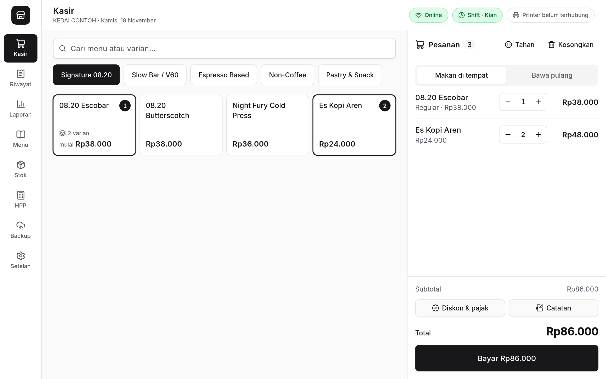
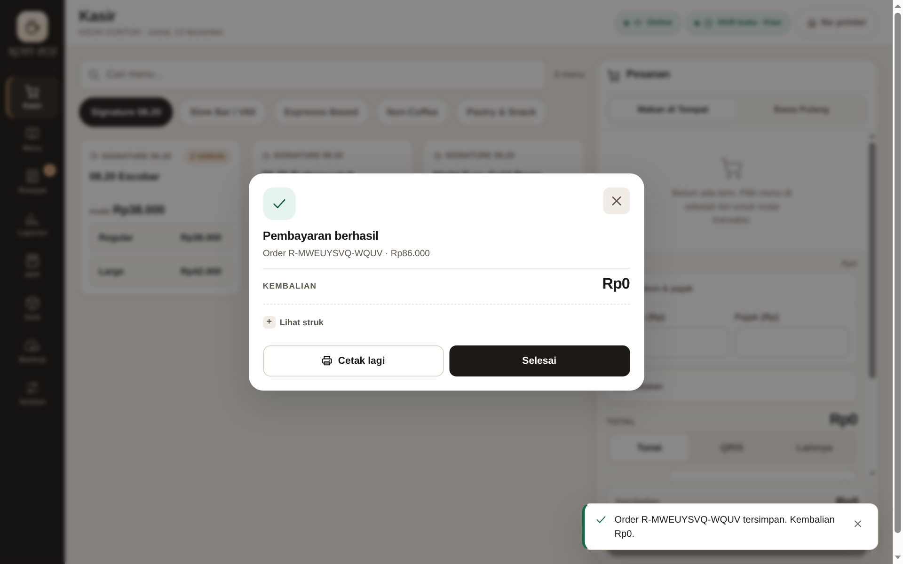
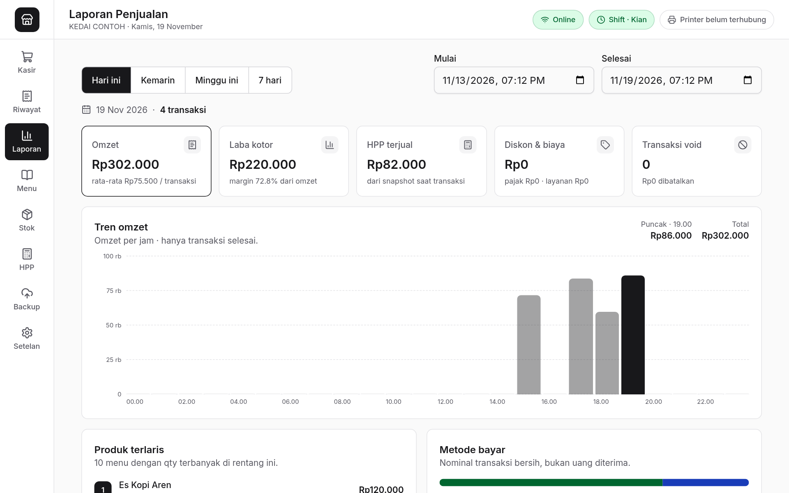
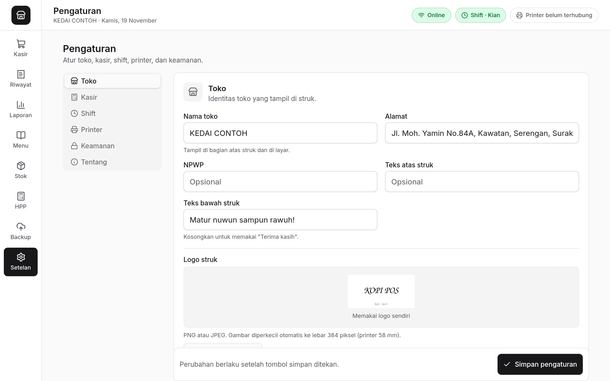
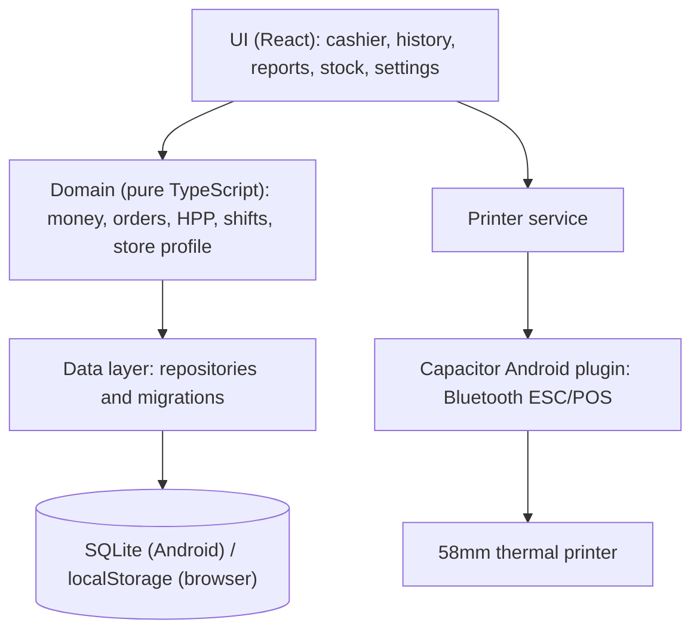

# ☕ Suro POS

**English** · [Bahasa Indonesia](README.id.md)

<p align="center">
  <strong>Open-source, offline-first tablet Point of Sale for cafés and small food &amp; beverage shops, with recipe-based cost tracking and 58mm Bluetooth receipt printing.</strong>
</p>

<p align="center">
  <a href="https://github.com/kianlabs/coffee-shop-pos/actions/workflows/ci.yml"></a>
  <a href="LICENSE"></a>
  
  
</p>

<p align="center">
  <strong>Status:</strong> v1.0.1 · 110/110 domain tests passing · Android APK via GitHub Releases
</p>

---

## Description

Suro POS runs on an Android tablet and keeps every sale on the device in a local SQLite database, so the counter keeps working when the internet does not. A sale is saved before anything is printed, prices are whole Rupiah (no floating-point money), and the cost of goods (HPP) is captured at the moment of sale so historical profit never changes when ingredient prices do.

It is built to be understood quickly: a plain React + TypeScript web app wrapped with Capacitor, with all business rules kept as pure functions that are unit tested.

There is no web demo — Suro POS is a tablet app. Install the APK from [GitHub Releases](https://github.com/kianlabs/coffee-shop-pos/releases/latest) or run it in the browser with the development instructions below.

## Screenshots

| Cashier | Receipt |
| :---: | :---: |
|  |  |

| Sales report | Settings |
| :---: | :---: |
|  |  |

The screenshots use sample data. Regenerate them with `node scripts/capture-tablet-screenshots.mjs` after `npm run build`.

## Features

- **Tablet-first cashier**: large touch targets, product search, category chips, variants, on-screen numpad, hold orders, dine-in and take-away.
- **Offline first**: all sales, stock movements, and shifts are committed to local SQLite. Optional sync is a background outbox and never blocks checkout.
- **Receipt printing**: ESC/POS over Bluetooth for 58mm thermal printers, including a raster store logo. A printer failure never cancels a saved sale.
- **Store profile**: store name, address, tax ID, logo, and receipt header/footer are all editable in Settings. Nothing is hard-coded to one shop.
- **Cost of goods (HPP)**: manual or recipe-based costing, per-ingredient stock ledger, and live margin warnings.
- **Void and refund**: protected by a supervisor PIN, with a persistent lockout after repeated wrong attempts. Stock is restored through ledger entries.
- **Shifts and reports**: opening cash, shift summary, daily and hourly sales, top products, payment-method split, gross profit.
- **Encrypted backup**: AES-GCM encrypted JSON export and restore.
- **Live updates**: over-the-air web bundle updates from GitHub Releases with rollback if the new bundle fails to start.

## Install the Android app

1. Open the [latest release](https://github.com/kianlabs/coffee-shop-pos/releases/latest) and download the `.apk` file.
2. On the tablet, allow installing apps from your browser or file manager when Android asks.
3. Open the downloaded file and install it.
4. Pair your Bluetooth printer in Android settings first, then connect it from **Setelan** (Settings) in the app.

APK files are published only on GitHub Releases and are not stored in the repository.

## Development

You only need Node.js 20 or 22. No Android SDK is required to run the app in a browser.

```bash
git clone https://github.com/kianlabs/coffee-shop-pos.git
cd coffee-shop-pos
npm install
npm run dev        # http://localhost:5173
```

Useful commands:

```bash
npm run typecheck  # TypeScript strict mode
npm test           # domain unit tests + repository guard tests (110 tests)
npm run build      # production web bundle
npm run smoke:ui   # headless Chromium UI smoke test (build first)
npm run test:e2e   # end-to-end flow test (build first)
npm run check      # repository guards (no client brand, no APK, no AI files)
```

Building the Android app additionally needs JDK 21 and the Android SDK:

```bash
npm run android:assets   # build web and sync into the Android project
npm run apk              # build a debug APK
```

The debug APK is written to `android/app/build/outputs/apk/debug/app-debug.apk`. In the browser, data is kept in `localStorage`; on Android it is kept in SQLite.

## Architecture



| Folder | Purpose |
| :--- | :--- |
| `src/domain/` | Business rules as pure functions, no React or database access |
| `src/data/` | Repositories, SQLite migrations, receipt formatting, printer, backup |
| `src/app/`, `src/features/`, `src/stores/`, `src/components/` | React UI |
| `android/` | Capacitor Android project and the native printer plugin |
| `database/` | Reference SQLite schema |
| `scripts/` | Tests, release packaging, repository guards |
| `docs/` | Technical documentation |

## Design rules

1. **SQLite on the device is the source of truth.** A sale never fails because the network is down.
2. **Save first, print second.** Printing problems cannot roll back or duplicate a committed sale.
3. **Integer Rupiah only.** No floating-point money.
4. **HPP is a snapshot.** Each order line keeps the unit cost at the time of sale.
5. **Every stock change is a ledger row**, tied to an idempotency key.

## What I Learned

- **Offline-first is a data-model decision, not a feature toggle.** Making SQLite the source of truth and sync a background outbox kept checkout working with zero network — and forced every other decision (idempotency keys, ledger-based stock) to follow.
- **Money must be integers.** Storing Rupiah as whole numbers removed an entire class of rounding bugs from HPP and profit reports.
- **Snapshots beat live lookups for history.** Capturing HPP at the moment of sale means old reports never change when ingredient prices do — a small choice that makes the numbers trustworthy.
- **Pure functions make business rules testable.** Keeping the domain layer free of React and database access is what makes 110 unit tests fast and meaningful.
- **Hardware fails — design for it.** A printer failing mid-sale must never cancel a saved sale, so "save first, print second" became a hard rule, not a preference.

## Documentation

- [Architecture and how to extend it](docs/architecture.md)
- [Checkout flow](docs/checkout-flow.md)
- [Data dictionary](docs/data-dictionary.md) and [ERD](docs/erd.md)
- [HPP and margin formulas](docs/hpp.md)
- [Printer flow](docs/printer-flow.md)
- [Offline sync flow](docs/offline-sync-flow.md)
- [Backup and recovery](docs/backup-recovery.md)
- [Project status](docs/status.md) and [open decisions](docs/open-decisions.md)

## Contributing

Contributions are welcome. Read [CONTRIBUTING.md](CONTRIBUTING.md) first, and report security problems privately as described in [SECURITY.md](SECURITY.md). Release notes are in [CHANGELOG.md](CHANGELOG.md).

## License

[MIT](LICENSE) © 2026 Kian Labs.
