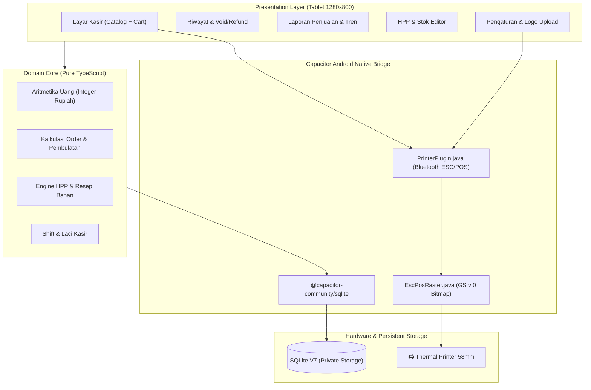

# ☕ Kopi POS

<p align="center">
  <strong>Production-ready, offline-first Tablet Point of Sale (POS) and inventory costing engine tailored for specialty coffee shops, slow bars, and micro-roasteries.</strong>
</p>

<p align="center">
  <a href="https://github.com/kianlabs/coffee-shop-pos/actions/workflows/ci.yml"></a>
  <a href="#-testing--quality-assurance"></a>
  <a href="#-testing--quality-assurance"></a>
  
  
  
  <a href="LICENSE"></a>
</p>

---

## 🌟 Highlights & Value Propositions

- 📟 **Tablet-First Landscape Ergonomics (1280×800)**: Designed specifically for 10"–11" counter tablets. Generous 44px+ touch targets, instant search, responsive category chips, tactile quantity steppers, and a sticky 380px order cart.
- ⚡ **100% Offline-First Architecture**: Powered by a robust local **SQLite V7** database engine. Operates seamlessly without internet connection; sales transactions and inventory updates are always committed instantly.
- 🖨️ **Hardware Native 58mm Thermal Printing**: Full Bluetooth ESC/POS hardware integration supporting monochrome raster logo printing (`GS v 0`), customizable store headers/footers, and clean automatic tear-line feeds.
- 🧮 **Automated HPP (COGS) & Recipe Costing**: Track gross margins down to the exact gram of espresso beans, milliliters of milk, and cup units. Live warnings for negative margins or loss-making items.
- 💰 **Strict Integer Rupiah Arithmetic**: Zero floating-point rounding errors. All prices, line items, and change calculations use integer Rupiah arithmetic with automated cashier rounding.
- 🔒 **Enterprise-Grade Security**: Supervisor/Owner PIN protection hashed via **PBKDF2** (100,000 iterations + salt), automated 5-minute lockout on brute-force attempts, and **AES-GCM (256-bit)** encrypted database exports.
- 💵 **Zero Monthly SaaS Subscription (Rp0)**: No recurring monthly vendor fees. The software, data, and hardware remain 100% owned by the merchant.

---

## 📸 Interface Showcase

| 🛒 Layar Kasir Tablet (1280×800) | 🧾 Struk Thermal 58mm dengan Logo |
| :---: | :---: |
| Antarmuka meja bar dengan multi-varian & keranjang | Hasil cetak struk thermal dengan logo toko custom |

| 📊 Laporan Penjualan & Tren 24 Jam | 📱 Responsif Smartphone Kasir |
| :---: | :---: |
| 5 Kartu KPI utama & grafik transaksi per jam | Bottom drawer fleksibel saat dibuka di ponsel kasir |

---

## 🏗️ System Architecture



---

## 🛠️ Tech Stack

| Layer | Technology | Description |
| :--- | :--- | :--- |
| **Frontend UI** | **React 19.3 + TypeScript** | Strict typing, zero-runtime overhead, memoized components |
| **Styling** | **Custom Vanilla CSS Design System** | Pure CSS (`theme.css`, 43 KB), warm coffee aesthetic, zero CSS framework bulk |
| **Bundler** | **Vite 8.3** | Sub-second HMR and optimized production code splitting |
| **Mobile Runtime** | **Capacitor 8.6** | Modern hybrid Android bridge container |
| **Database** | **SQLite V7** | Native Android SQLite with schema migrations, indexes, and atomic transactions |
| **Hardware Bridge** | **Java (Android SDK 34 / JDK 21)** | Custom Bluetooth RFCOMM ESC/POS printer adapter with raster logo converter |
| **Security** | **Web Crypto API (PBKDF2 & AES-GCM)** | Industry-standard cryptographic key derivation and data encryption |
| **Testing** | **Node.js Test Runner + Playwright CDP** | 110 domain unit tests + 31 automated headless UI smoke tests |

---

## 📁 Repository Structure

```text
coffee-shop-pos/
├── android/                        # Proyek native Android (Capacitor + Java plugins)
│   ├── app/src/main/java/.../      # PrinterPlugin.java & EscPosRaster.java
│   └── app/proguard-rules.pro      # Aturan ProGuard untuk rilis produksi
├── database/
│   └── sqlite-schema.sql           # Schema DDL SQLite V7 referensi
├── docs/                           # Dokumentasi teknis & arsitektur mendalam
│   ├── checkout-flow.md            # Diagram alur transaksi checkout
│   ├── data-dictionary.md          # Kamus data tabel & relasi
│   ├── erd.md                      # Entity Relationship Diagram (Mermaid)
│   ├── hpp.md                      # Dokumentasi formula perhitungan HPP & margin
│   ├── printer-flow.md             # Protokol Bluetooth ESC/POS & bitmap logo
│   └── status.md                   # Catatan verifikasi & status rilis
├── scripts/                        # Skrip build, test, dan utilitas
│   ├── build-apk.sh                # Skrip kompilasi otomatis APK Android
│   ├── capture-tablet-screenshots.mjs # Pengambil tangkapan layar otomatis headless
│   ├── smoke-ui.mjs                # 31 pengujian UI end-to-end via Chromium CDP
│   └── test-domain.mjs             # 110 pengujian logika domain & aritmetika Rupiah
├── src/                            # Kode sumber aplikasi Web/React
│   ├── components/                 # Komponen antarmuka (Kasir, HPP, Stok, Laporan)
│   ├── data/                       # Repositori SQLite, migrasi V7, printer, & settings
│   ├── domain/                     # Logika bisnis inti murni (money, orders, catalog, hpp)
│   └── styles/theme.css            # Design system CSS tablet-first
├── Rahardjo-Coffee-POS-v1.0.apk    # File installer APK Android siap pakai (14 MB)
├── package.json
└── vite.config.ts
```

---

## 🚀 Quick Start Guide

### Prasyarat
- **Node.js**: v20.x atau v22.x
- **NPM**: v10+
- **JDK 21** (opsional, hanya diperlukan jika ingin meng-compile file APK Android)

### 1. Instalasi & Menjalankan Mode Development
```bash
# Clone repository
git clone https://github.com/kianlabs/coffee-shop-pos.git
cd coffee-shop-pos

# Install dependensi
npm install

# Jalankan dev server lokal
npm run dev
```
Buka peramban di `http://localhost:5173`.

### 2. Menjalankan Pengujian (Quality Assurance)
```bash
# Typecheck TypeScript (Strict mode)
npm run typecheck

# 110 Unit Tests (Aritmetika Uang, Validasi Checkout, HPP, Refund, PIN)
npm test

# 31 UI Smoke Tests (Chromium Headless CDP)
npm run smoke:ui
```

### 3. Build Web Production & Android Assets
```bash
# Compile bundle web produksi
npm run build

# Sinkronkan aset web ke folder assets Android
npm run android:assets
```

### 4. Kompilasi APK Android
```bash
# Otomatis compile file APK Android (memerlukan JDK 21)
npm run apk
```
File APK siap instalasi akan dihasilkan di `android/app/build/outputs/apk/debug/app-debug.apk`.

---

## 🖨️ Panduan Hardware Thermal Printer 58mm

Aplikasi ini kompatibel dengan hampir seluruh printer thermal Bluetooth 58mm standar di pasaran (Panda, VSC, Eppos, Iware, RPP02N, Zjiang, MTP-2, GOOJPRT):

1. **Sandingkan Bluetooth**: Di tablet Android, buka *Settings -> Bluetooth*, cari perangkat printer kasir dan masukkan PIN pairing default (`0000` atau `1234`).
2. **Koneksi di Aplikasi**: Buka menu **Setelan** di POS -> Pada kartu printer, klik **Scan Bluetooth** -> Pilih perangkat printer -> Klik **Hubungkan**.
3. **Cetak Logo Toko**:
   - Format file logo yang didukung: PNG, JPEG, atau WebP (disarankan kontras tinggi / monokrom).
   - Dimensi optimal: Lebar 384 piksel (sesuai spesifikasi thermal head 58mm).
   - Gambar otomatis dikonversi oleh native raster engine ke format ESC/POS bit image `GS v 0` tanpa memakan RAM tablet.

---

## 📜 Invarian & Prinsip Desain Kritis

1. **Local-First Single Source of Truth**: SQLite pada tablet adalah kebenaran operasional mutlak. Tidak boleh ada transaksi yang gagal hanya karena koneksi internet terputus.
2. **Atomic Commits Before Printing**: Transaksi penjualan wajib tersimpan aman di SQLite terlebih dahulu sebelum perintah cetak dikirim ke printer thermal. Kegagalan printer atau kehabisan kertas tidak boleh membatalkan (*rollback*) penjualan yang sudah sah.
3. **Integer Money Only**: Seluruh nominal Rupiah disimpan dalam bentuk bilangan bulat integer murni untuk mengeliminasi *floating-point money drift*.
4. **HPP Immutability**: Nilai HPP per cup dicatat sebagai snapshot permanen pada setiap baris order saat checkout terjadi, memastikan laporan laba historis tidak berubah ketika harga bahan baku naik di masa depan.

---

## 📄 Lisensi

Proyek ini dilisensikan di bawah lisensi **[MIT License](LICENSE)** — Hak Cipta (c) 2026 **Kian Labs**. Bebas digunakan, dimodifikasi, dan didistribusikan untuk keperluan komersial maupun pribadi.
