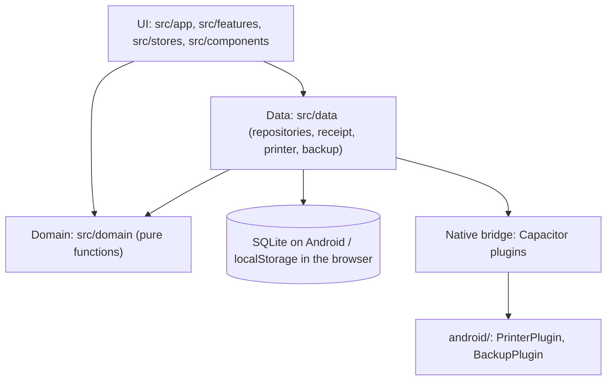

# Architecture

This document explains how Kopi POS is organized and how to extend it. It describes the code as it is today.

## Layers

| Layer | Folder | Rule |
| :--- | :--- | :--- |
| Domain | `src/domain/` | Pure TypeScript functions: money, orders, HPP, shifts, units, store profile, sales aggregation. No React, no storage, no Capacitor, no clock reads unless passed in. |
| Data | `src/data/` | Reads and writes storage, formats receipts, talks to the printer, encrypts backups, runs the sync outbox. May import `src/domain/`. |
| Services | `src/services/` | App-level services such as the over-the-air updater. |
| UI | `src/app/` (shell, navigation), `src/features/<screen>/`, `src/stores/` (Zustand), `src/components/ui/` (shadcn/ui), `src/components/common/` | React. Calls the data layer and domain functions. Follows [design-system.md](design-system.md). |
| Native bridge | `android/app/src/main/java/.../` | Java plugins registered in `MainActivity.java`: `PrinterPlugin` (Bluetooth ESC/POS) and `BackupPlugin` (file access). |

Keep business rules in the domain layer. A rule that lives in a pure function can be unit tested in `scripts/test-domain.mjs` without a browser or a database.

## The two storage backends

Storage is chosen at startup by `isNativePlatform()` in `src/data/db.ts`:

| | Android app | Browser (dev, demo, e2e) |
| :--- | :--- | :--- |
| Orders | SQLite via `src/data/orderRepository.ts` | `localStorage` via `src/data/orderStore.ts` |
| Catalog | SQLite via `src/data/catalogRepo.ts` | `localStorage` via `src/data/catalogStore.ts` |
| Store profile | SQLite table `app_settings` | `localStorage` key `pos.store-profile.v1` |

`src/data/orderRepo.ts` exposes one interface and picks the backend. **Any feature that saves data must work on both backends.** In the browser, calling `getDb()` waits forever, because the app does not open SQLite there. Check `isNativePlatform()` first, as `catalogRepo.ts` and `storeProfile.ts` do.

## Request flow for a sale

1. The cashier builds a cart in the UI. Totals come from `src/domain/money.ts` and `src/domain/orders.ts`.
2. Checkout validates the input, then writes the order, its lines, payments, cost snapshot, and stock movements in **one transaction**. See [checkout-flow.md](checkout-flow.md).
3. Only after the commit does the UI render the receipt text (`src/data/receipt.ts`) and send it to the printer. A print failure never undoes the sale.
4. If sync is configured, an event is added to the `sync_outbox` table in the same transaction. See [offline-sync-flow.md](offline-sync-flow.md).

All writes to one SQLite connection go through `runSerializedWrite` in `src/data/tx.ts`, so two writes cannot overlap.

## How to add a feature

1. Put the rule in `src/domain/` as a pure function and add cases to `scripts/test-domain.mjs`. New files must also be added to the `tsc` file list at the top of that script.
2. If the feature saves data, add storage for **both** backends (see above).
3. Add UI in the screen's folder under `src/features/`. Shared state goes in `src/stores/`, shared building blocks in `src/components/common/`. Keep files under 200 lines.
4. Run `npm run typecheck`, `npm test`, `npm run build`, and `npm run check`.
5. Add a line to `[Unreleased]` in [CHANGELOG.md](../CHANGELOG.md).

## How to add a database migration

SQLite schema changes are applied by the Capacitor SQLite plugin through upgrade statements. Today the schema is at version 7.

1. In `src/data/migrations.ts`, add `export const UPGRADE_V8: string[] = [ ... ]` with plain `CREATE TABLE IF NOT EXISTS` or `ALTER TABLE` statements, and raise `DB_VERSION` to `8`.
2. In `src/data/db.ts`, import `UPGRADE_V8` and add `{ toVersion: 8, statements: UPGRADE_V8 }` to the list passed to `addUpgradeStatement`.
3. The plugin may skip upgrade statements for an existing connection, so `db.ts` also re-applies changes idempotently every time a connection opens (see `ensureV4Columns` and `ensureV7Indexes`). Add an `ensureV8...` function in the same style, using `tableHasColumn` before any `ALTER TABLE ADD COLUMN`.
4. Update `database/sqlite-schema.sql` so it matches the result.
5. Update [data-dictionary.md](data-dictionary.md) and [erd.md](erd.md) when tables or columns change.
6. Never change a past `UPGRADE_Vn`. Write a new version instead.

## How to add a payment method

A payment method appears in several places that must stay in sync:

1. `PaymentMethod` type in `src/domain/orders.ts`.
2. `PAYMENT_METHODS` list in `src/data/orderStore.ts` (browser backend validation).
3. The `CHECK (method IN (...))` constraint on the `payments` table. SQLite cannot alter a CHECK constraint in place, so this needs a table rebuild in one transaction. `ensureV3Columns` in `src/data/db.ts` is an example of that pattern.
4. `paymentLabel` in `src/data/receipt.ts`, which names the method on the receipt.
5. `METHODS` in `src/features/kasir/PaymentDialog.tsx`.
6. Aggregation in `src/domain/sales.ts` (the report groups by method).

Add test cases for each of these, and update `database/sqlite-schema.sql`.

## How to add a language

The interface is currently Indonesian only, and strings are written directly in the components. There is no translation layer yet, so adding a language means first introducing one. If you want to work on this, open an issue to agree on the approach before starting.

## Native bridge

Plugins are Java classes in `android/app/src/main/java/com/kianlabs/coffeeshoppos/` and are registered in `MainActivity.java`. The web side calls them through Capacitor. To change printing behavior, start with `PrinterPlugin.java` and `EscPosRaster.java` (logo raster), and read [printer-flow.md](printer-flow.md). Building the Android project needs JDK 21 and the Android SDK; the web app does not.

## Security notes

- PINs are stored only as PBKDF2-hashed values with a random salt (`src/data/settings.ts`).
- Encrypted backups use AES-GCM with a PBKDF2-derived key (`src/data/cryptoBackup.ts`).
- Never commit secrets, signing keys, APK files, or assistant instruction files. `npm run check` enforces the last two, and CI runs it.
