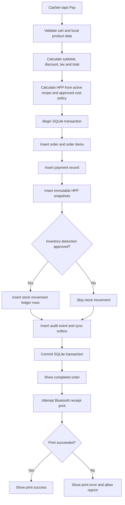

# Checkout Transaction Flow

## Invariants
- If any critical insert fails, rollback the whole SQLite transaction.
- A committed order is not rolled back just because the printer is offline.
- Reprint references the existing order ID; it never creates a new order/payment.
- Use a unique order ID/idempotency key and disable accidental double-submit while checkout is processing.
- Confirm rounding, discount allocation, tax/service charge, and refund behavior with the client.
