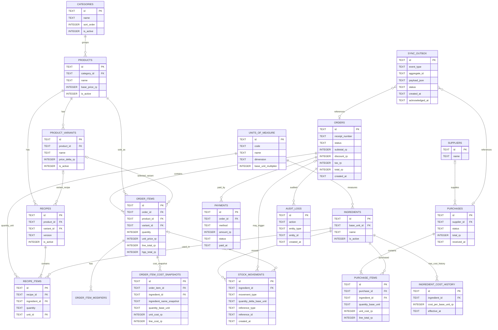

# Entity Relationship Diagram

The diagram shows the proposed local operational data model. Some modules are conditional:
- Purchasing tables are needed only if purchase recording is in scope.
- Stock deduction from recipes requires client approval.
- User/role tables can be added if cashier/owner access control is required.

## Notes
- All IDs are UUID strings generated on the device.
- Money columns use integer Rupiah.
- Quantities use decimal text in this draft to avoid SQLite floating-point arithmetic. In implementation, define a fixed-precision strategy (for example integer milli-units) and enforce it consistently.
- `ORDER_ITEM_COST_SNAPSHOTS` preserves the cost composition at sale time. `ORDER_ITEMS.hpp_total_rp` stores the aggregate snapshot for fast reporting.
- `STOCK_MOVEMENTS` is an append-only ledger; current stock is calculated from movement sums or maintained as a transactionally updated projection.
- `SYNC_OUTBOX` is local durable queue. Do not delete pending rows before server acknowledgement.
