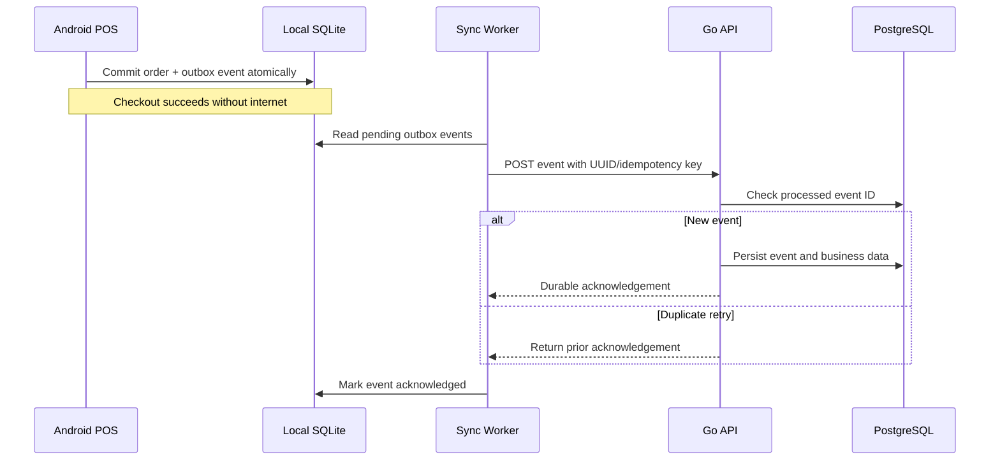

# Offline Sync Flow

## Rules
- Server must enforce a unique constraint on event ID.
- Client retries must be safe.
- Local event is marked acknowledged only after durable server acknowledgement.
- Do not delete local order data after sync.
- Conflict policy for product/recipe/stock edits must be specified before multi-device support.
- Cloud sync is optional and must not block local checkout.
