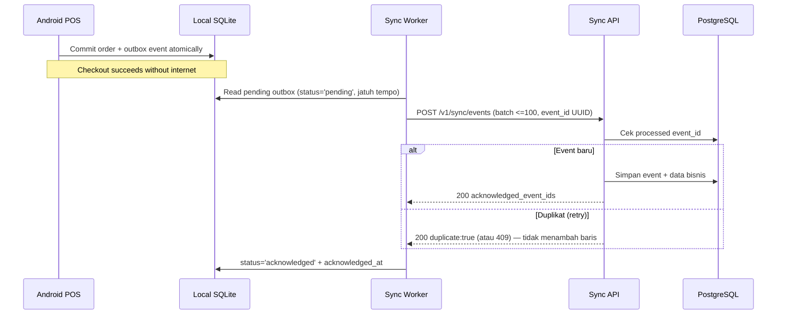

# Offline Sync Flow

## Aturan kontrak
- Server wajib unik per `event_id`; duplikat dibalas 200 `duplicate: true` (boleh 409 dengan body sama) dan **tidak** menambah baris.
- `event_id` adalah UUID murni (`format: uuid`). Client menurunkannya deterministik dari `sync_outbox.id` (FNV-1a 128-bit → UUID v4-shaped), jadi retry mengirim UUID yang sama. Jangan ubah algoritma itu tanpa migrasi.
- Id lokal (`sync_outbox.id`, mis. `<order-id>-evt`) tetap disimpan di SQLite dan tidak dikirim ke server.
- Event lokal ditandai `acknowledged` hanya setelah server membalas durable.
- Data order lokal TIDAK dihapus setelah sync (belum ada retensi/auto-purge).
- Sync cloud opsional dan tidak boleh memblokir checkout lokal.

## Perilaku client (`src/data/sync.ts`)
- **Satu sync dalam satu waktu.** `syncNow()` memakai lock modul: interval 60 detik dan tombol manual berbagi promise yang sama, jadi tidak ada dua request untuk batch yang sama.
- **Timeout 15 detik** per request (`SYNC_TIMEOUT_MS`) via `AbortController`; `pushEvents()` menerima `signal` eksternal + `timeoutMs`.
- **Klasifikasi hasil:**

  | Kondisi | Status outbox | Aksi |
  |---|---|---|
  | 2xx / 409 / `duplicate: true` | `acknowledged` | tidak dikirim ulang |
  | 429, 5xx, 408, network error, timeout | tetap `pending` | `attempt_count+1`, `next_attempt_at` = backoff |
  | 400, 401, 403, 404, 422 | `failed` | terminal, tidak di-retry otomatis |
  | endpoint default / bukan https / kosong | tidak diubah | error konfigurasi lokal |

- **Backoff** eksponensial 30 detik × 2^attempt, maksimum 1 jam; hanya event yang `next_attempt_at`-nya sudah lewat yang dikirim.
- **Batch** maksimum 100 event per putaran.
- **Event yang tidak di-ack dan tidak ditolak** dianggap belum terkirim → retry.
- **Event `failed`** dikembalikan manual dengan `requeueFailedEvents()` (reset attempt) setelah endpoint/API key diperbaiki. Belum ada tombolnya di UI.
- **Endpoint wajib `https://`.** `http://` hanya diizinkan untuk `localhost`/`127.0.0.1`/`::1` (mock dev).
- **`device_id`** dari settings (dibuat sekali, persisten) dikirim di body setiap request.
- **API key** disimpan plaintext di `localStorage` (`pos.sync.v1`) karena tidak ada dependency secure storage; key hanya dipakai sebagai header `Authorization: Bearer` dan tidak pernah ditulis ke console/log.

## Mock server (`scripts/mock-sync-server.mjs`)
- Jalankan: `npm run mock:sync` atau `node scripts/mock-sync-server.mjs --port 8787`.
- Auth: `Authorization: Bearer <MOCK_TOKEN>`, default `dev-token`; `MOCK_TOKEN=none` mematikan auth.
- Endpoint: `POST /v1/sync/events`, `GET /health` (alias `/v1/health`), `GET /events?since=<ISO>` (inspeksi, butuh auth).
- State di memori (`Map` per `event_id`) — hilang saat restart; duplikat dibalas `duplicate: true` tanpa menambah baris.
- Validasi 400 bila `device_id`, `event_id`, `event_type`, atau `aggregate_id` hilang; `event_id` juga harus UUID.
- `payload.__reject = true` → masuk `rejected` (untuk menguji jalur `failed`).

## Status implementasi (Nov 2026)
- DEFAULT terkunci offline: `DEFAULT_SYNC_ENDPOINT=https://api.example.invalid`; `pushEvents/syncNow` menolak kirim selama masih default.
- Tanpa server nyata + API key, operasional = offline-first + backup file (`docs/backup-recovery.md`); jangan klaim cloud aktif sebelum restore teruji.
- Belum ada: retensi/purge event `acknowledged`, kompresi payload, multi-device conflict resolution, dan UI untuk requeue event `failed`.
