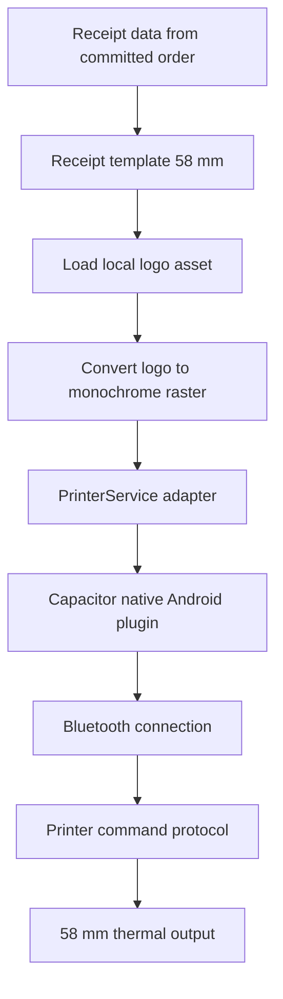

# Bluetooth Thermal Printer — 58 mm

## Confirmed requirement
- Bluetooth desktop/large thermal receipt printer.
- Paper width: 58 mm.
- Logo printing desired.

## Proposed integration

## Hardware gate — do not skip
Obtain exact printer brand/model and manual/SDK. Verify:
- Bluetooth Classic SPP/RFCOMM or BLE.
- ESC/POS support or vendor-specific protocol.
- Android version compatibility and permissions.
- Actual printable dot width, margins, and character set.
- Raster/image command support for logo.
- Cutter support (if present).
- Reconnect behavior and status/error reporting.

“Bluetooth 58 mm” alone does not guarantee ESC/POS or logo support.

## Status implementasi (Nov 2026)
- Web fallback: `src/data/printer.ts` `WebPrinter` cetak via iframe same-origin + `print()`.
- Bridge native: `EscPosPrinter` kirim base64 ESC/POS ke Capacitor `PrinterPlugin`
  (`android/.../PrinterPlugin.java`, terdaftar di `MainActivity`; permission BT/USB di manifest).
- Logo: `public/assets/logo.png` → `LOGO_ASSET_PATH="assets/logo.png"` → `printLogo({dataPngBase64})`;
  tanpa file/plugin fallback "[LOGO]". Rasterisasi penuh menunggu SDK vendor di `sendToPrinter`.
- Pintu hardware tetap berlaku: tanpa merek/model + SDK, native = stub log ukuran byte.

