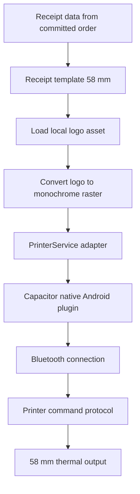

# Bluetooth Thermal Printer — 58 mm

## Confirmed requirement
- Bluetooth desktop/large thermal receipt printer.
- Paper width: 58 mm.
- Logo printing desired.

## Proposed integration

## Hardware gate — do not skip
Obtain exact printer brand/model and manual/SDK. Verify:
- Bluetooth Classic SPP/RFCOMM or BLE.
- ESC/POS support or vendor-specific protocol.
- Android version compatibility and permissions.
- Actual printable dot width, margins, and character set.
- Raster/image command support for logo.
- Cutter support (if present).
- Reconnect behavior and status/error reporting.

“Bluetooth 58 mm” alone does not guarantee ESC/POS or logo support.

## Print behavior
- Save/commit sale locally before printing.
- Print failure must not lose or duplicate the transaction.
- Reprint from order history must reuse the same order.
- Keep logo asset on device; no internet dependency.
- Test logo size, threshold/dithering, alignment, long receipts, paper-out, disconnect, and app restart.
